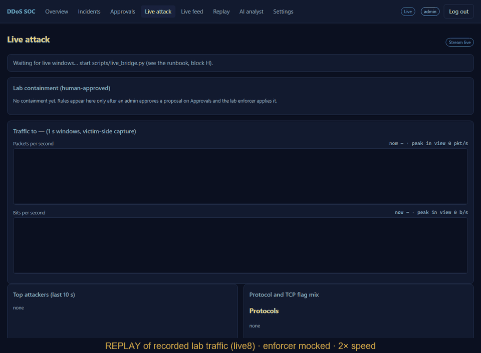
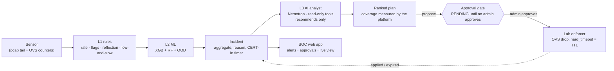

# DDoS Detection & Response Platform

**Real-time DoS/DDoS detection with layered rules + ML, an AI SOC analyst that explains every alert, and
human-approved containment, demonstrated live in a Mininet lab.**

<p align="center">
  
</p>

[](https://github.com/Shadowprofessor/DDOS-Attack-Detection/actions/workflows/tests.yml)
[](https://github.com/Shadowprofessor/DDOS-Attack-Detection/actions/workflows/codeql.yml)
[](LICENSE)
[](https://www.python.org/)
[](https://github.com/Shadowprofessor/DDOS-Attack-Detection/releases/latest)

<p align="center"><sub>A <b>replay</b> of the recorded live8 lab run at 2× speed. The approval is re-enacted at its real time, and the lab enforcer is mocked. The switch-counter drop is the one recorded after the real approved rule. How it is made: <a href="scripts/record_demo.md">scripts/record_demo.md</a>.</sub></p>

## What it does

- **L0: approval gate.** Every block is a PENDING proposal. Only a human admin, through
  `PendingActionManager.approve()`, can enforce one. An AST test fails the build if any other path to
  enforcement appears.
- **L1: rules.** Packet sanity, per-destination rate thresholds and adaptive baselines, SYN/ACK/RST/LAND,
  reflection by source port, and handshake-aware low-and-slow. Each alert carries a plain-language reason
  with its numbers.
- **L2: ML.** An XGBoost + Random Forest ensemble on 77 CICFlowMeter features (CIC-DDoS2019 + labelled lab
  traffic), plus a calibrated out-of-distribution signal for zero-day traffic.
- **L3: AI analyst.** NVIDIA Nemotron 3.5 Lightning sees one sanitised, aggregated incident at a time, never
  packets. It uses read-only tools to name the attack, explain it, and propose a ranked containment plan.
  It **recommends and never executes**, and falls back to a deterministic rule analyst.
- **L4: response.** NIST SP 800-61r3 incident lifecycle with a hash-chained timeline, the CERT-In 6-hour timer,
  and a SOC web app:
  - live attack view;
  - alerts with sound, browser notifications and an optional webhook;
  - Markdown/PDF export.

  In the lab, an approved rule is installed on the Open vSwitch with a TTL and removes itself.



## Results

All numbers are measured, and dev and held-out are never merged. The block below is generated from the
results files by `scripts/readme_results.py`. CI fails if it drifts from them or from `REPORT.md`.

<!-- RESULTS:START (generated by scripts/readme_results.py; do not edit by hand) -->

#### Live demo (Mininet on WSL2 → SOC website, real time)

| Run | Scenario | Attack start → alert on website | L3 (Lightning) named it |
|---|---|---:|---|
| live4 | syn flood | 5.16 s | SYN flood |
| live4 | udp flood | 2.66 s | SYN flood |
| live5 | syn flood | 5.52 s | SYN flood (Direct Network Flood) |
| live5 | udp flood | 8.55 s | SYN flood (TCP-based network DoS) |
| live7 | syn flood | 3.49 s | SYN flood |
| live7 | udp flood | 3.04 s | SYN flood mislabelled by ML; actual traffic is UDP flood… |
| live8 | syn flood | 4.89 s | SYN flood |
| live8 | udp flood | excluded (1) | SYN flood |
| live9 | syn flood | 6.23 s | SYN flood |
| live9 | udp flood | 3.04 s | SYN flood (TCP-based direct network flood) |
| live6 | — | lost (2) | — |

(1) live8 udp flood: the SYN flood's 300 s port rule was still active when this flood started, so it never reached the victim; it was detected ~1.5 s after the rule expired.
(2) live6: the bridge exited because the server was not up; nothing reached the website (fixed in v5.4.0: the bridge now waits).

**Live MTTD:** 2.66–8.55 s, median 4.89 s (9 floods). Includes ~3–7 s of bridge lag (pcaps are tailed from a shared disk).

| Run | Rule (approved by a human admin) | Approval → rule on switch | **MTTC** (approval → victim < 100 pps) | Victim pps before → 15 s after |
|---|---|---:|---:|---|
| live5 | 10.99.0.144 | 0.58 s | not reached | 2994 → 2940 (2%) |
| live8 | attacker | 0.61 s | **2.63 s** | 2997 → 0 (100%) |
| live9 | attacker | 0.84 s | **3.55 s** | 1493 → 124 (92%) |

#### Offline lab coverage: DEV (tuned on) vs HELD-OUT (never tuned on), kept separate

| Scenario | DEV (runs 2+3) | HELD-OUT (run4) |
|---|---|---|
| benign baseline | no alarm ✓ | no alarm ✓ |
| dns reflection sim | detected, 0.9 s | detected, 1.2 s |
| flash crowd | no alarm ✓ | no alarm ✓ |
| http low and slow | detected, 117.3 s | detected, < 0 s† |
| icmp flood | detected, 55.8 s | detected, < 0 s† |
| land attack | detected, 60.8 s | detected, 61.1 s |
| novel ood mix | detected, 1.4 s | detected, 1.3 s |
| ntp reflection sim | detected, 1.2 s | detected, 1.3 s |
| syn flood | detected, 1.0 s | detected, 1.4 s |
| tcp ack flood | detected, 1.2 s | detected, 1.3 s |
| tcp rst flood | detected, 1.5 s | detected, 1.4 s |
| udp flood | detected, 0.9 s | detected, 1.3 s |

Held-out: **10/10 attacks detected**, **0/2 false alarms** on benign + flash-crowd traffic. Times are offline MTTD after flow export.
† negative: L2 flagged 2-packet victim fragments just before the scenario started (a known false-positive source, not tuned away).

#### Agent triage accuracy vs lab ground truth (10 attacks + 2 benign per set)

| | Rules | Lightning (LLM) | ML (L2) |
|---|---:|---:|---:|
| Attack type correct, DEV | 10/10 | 8/10 | 7/10 |
| Attack type correct, HELD-OUT | 10/10 | 8/10 | 7/10 |
| False alarms (benign, flash crowd), DEV | 0% | 0% | 0% |
| False alarms (benign, flash crowd), HELD-OUT | 0% | 0% | 0% |

Lightning's held-out misses: land attack → "SYN flood"; ntp reflection sim → "Benign / flash crowd". **Live, it called the UDP flood a "SYN flood" in 4 of 5 runs**; v6.1.0 found one cause (the incident carried the previous flood's ML label) and fixed it, not yet re-measured live.

<!-- RESULTS:END -->

Full method, per-class ML numbers and the injection evaluation: [**REPORT.md**](REPORT.md).

## Limitations

- **Not proven on real traffic.**
  - Everything above comes from one lab: one traffic generator, one network, floods of ≤ 1,500–3,000 pkt/s
    from a single host.
  - No production deployment, no real ISP traffic, no multi-Gbps floods.
- **Lab-generator bias.** The ML reaches 99.95% held-out attack detection only after training on traffic
  from the *same* generator, so treat it as an upper bound. Before that, the CIC-trained model flagged
  **0 of 1,452** lab SYN-flood flows.
- **Cross-dataset is inconclusive.** On CICIoT2023, F1 swings 1.00 → 0.05 depending only on how the 57
  unmapped features are filled. No same-extractor test has been done.
- **Weak spots.**
  - ML recall is weak on ICMP (0.27), reflection (0.32) and Slowloris (0.50).
  - Live detection includes ~3–7 s of bridge lag.
  - Low-and-slow takes ~2 minutes to confirm.
- **The AI misnames attacks** (shown in the tables above, not hidden).
  - The rules beat it on held-out triage.
  - Live, it called the UDP flood a "SYN flood" in most runs.
  - Its plans proposed single-IP drops that would have stopped ~0–2% of the flood. The platform's own
    coverage measurement, not the model, picks the effective step.
- **The live capture under-counts under load.**
  - The victim-side `tcpdump` (writing to the shared Windows disk) recorded bursts of 0–4,700 pkt/s,
    while the switch delivered a steady ~3,000 pkt/s.
  - Alerts still fire, and MTTC is measured from the switch counters, which the Live attack page now
    also charts.
- **Containment is proven on one attack shape**: all sources behind one switch port, n = 2 successful live runs.
- **Human-in-the-loop is slow by design.** Attack start → contained was 41–58 s, mostly the human approving.
  There is no auto-approve.
- **Security gaps.** Shared API keys (no per-user identity or MFA), unauthenticated `/metrics`, model
  artifacts not hash-pinned, and injection tested only with static payloads.

## Quick start

```bash
pip install -r requirements.txt && (cd dashboard && npm ci && npm run build)
export DDOS_API_KEYS=demo-analyst-key-01 DDOS_ADMIN_KEYS=demo-admin-key-0001   # PowerShell: $env:DDOS_API_KEYS="..."
python -m uvicorn src.api.app:app --host 127.0.0.1 --port 8000                  # open http://localhost:8000/app
```

- Sign in with `demo-admin-key-0001`, open **Replay**, and run `syn_flood`. No traffic and no LLM key are
  needed: the analyst falls back to rules.
- Models and datasets are gitignored. Without them, L2 uses a dummy classifier. See
  [Getting the data](#getting-the-data).
- **Full live demo** (a Mininet attack → alert → AI plan → you approve → traffic drops):
  [RUNBOOK block H](docs/RUNBOOK.md#h-live-demo-mininet-attack--alert--ai-plan--human-approved-containment-v600)
  and the [5-minute demo script](docs/DEMO.md).

## Getting the data

Datasets and trained models are large and gitignored.
1. Download [CIC-DDoS2019](https://www.unb.ca/cic/datasets/ddos-2019.html), and
   [CICIoT2023](https://www.unb.ca/cic/datasets/iotdataset-2023.html) for the cross-dataset check.
2. Build the 77-feature parquets and train the models.

Full steps, model artifacts, configuration and the operator guide: [docs/REFERENCE.md](docs/REFERENCE.md).
Datasets and their terms: [docs/DATASETS.md](docs/DATASETS.md).

## Safety

- The LLM is never in the packet path, and telemetry is treated as untrusted (sanitised and wrapped in
  `<telemetry>`).
- No model or LLM output can block traffic.
- Lab traffic stays inside an isolated Mininet network: code-enforced scope and rate caps, a kill switch,
  and an egress containment proof before every run.
- Keys come from the environment only.

Details: [REPORT.md §4](REPORT.md#4-safety-model), [STRIDE](docs/security/STRIDE.md),
[SECURITY.md](SECURITY.md).

## More

[Runbook](docs/RUNBOOK.md) · [Demo script](docs/DEMO.md) · [Technical report](REPORT.md) ·
[Detection latency](docs/DETECTION_LATENCY.md) · [Purple-team lab](docs/purple_team/README.md) ·
[SOC app](docs/SOC_APP.md) · [Incident response](docs/IR.md) · [GRC mapping](docs/grc/control_mapping.md) ·
[Changelog](CHANGELOG.md) · [Contributing](CONTRIBUTING.md) · [Cite this](CITATION.cff)

## Citations and credits

- **CIC-DDoS2019:** I. Sharafaldin, A. H. Lashkari, S. Hakak, A. A. Ghorbani, "Developing Realistic Distributed
  Denial of Service (DDoS) Attack Dataset and Taxonomy," ICCST 2019.
  <https://www.unb.ca/cic/datasets/ddos-2019.html>
- **CICIoT2023:** E. C. P. Neto et al., "CICIoT2023: A Real-Time Dataset and Benchmark for Large-Scale Attacks
  in IoT Environment," *Sensors*, 2023. <https://www.unb.ca/cic/datasets/iotdataset-2023.html>
- **MITRE ATT&CK:** T1498 Network Denial of Service <https://attack.mitre.org/techniques/T1498/> and T1499
  Endpoint Denial of Service <https://attack.mitre.org/techniques/T1499/>
- **NIST SP 800-61r3,** *Incident Response Recommendations and Considerations for Cybersecurity Risk
  Management* (2025). <https://csrc.nist.gov/pubs/sp/800/61/r3/final>
- **CERT-In** Directions u/s 70B(6), No. 20(3)/2022-CERT-In, 28 April 2022.
  <https://www.cert-in.org.in/PDF/CERT-In_Directions_70B_28.04.2022.pdf>
- **NVIDIA Nemotron 3.5 Lightning** (`nvidia/nemotron-3.5-lightning-30b-a3b`), via the NVIDIA API.
  <https://docs.api.nvidia.com/nim/reference/nvidia-nemotron-3-5-lightning-30b-a3b>
- **Mininet** <https://mininet.org/> and **Open vSwitch** <https://www.openvswitch.org/>

Author: Sachit Sharma (NIIT University). Licence: [MIT](LICENSE).
