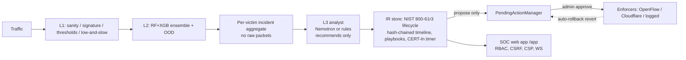

# DDoS Detection & Mitigation Platform: Technical Report (v6.1.0)

Author: Sachit Sharma. Licence: MIT.

## 1. Summary

A layered, defence-in-depth DDoS/DoS detection and **human-approved** response platform for
SDN and cloud-edge networks. It has four layers:
- **L0** approval-gated mitigation;
- **L1** rule detectors;
- **L2** ML ensemble with an OOD signal;
- **L3** LLM/rule analyst that only recommends.

Around them sit an incident-response backend, a SOC web app, and a purple-team lab with
code-enforced containment.

**Results at a glance.** The block below is generated from the results files by `scripts/readme_results.py`;
README.md carries the identical block, and CI fails if either drifts. Other headline numbers:
- L2 macro-F1: CIC test_real_v2 0.917, held-out lab 0.800 (§5.5).
- Prompt-injection success with defences: 0/31, static payloads (§4).
- Lab egress probes dropped: 3/3 in each of 14 runs (run2–4, train1, live1–9), 0 on the uplink. One
  earlier diagnostic run was inconclusive: the probe never reached the boundary.

<!-- RESULTS:START (generated by scripts/readme_results.py; do not edit by hand) -->

#### Live demo (Mininet on WSL2 → SOC website, real time)

| Run | Scenario | Attack start → alert on website | L3 (Lightning) named it |
|---|---|---:|---|
| live4 | syn flood | 5.16 s | SYN flood |
| live4 | udp flood | 2.66 s | SYN flood |
| live5 | syn flood | 5.52 s | SYN flood (Direct Network Flood) |
| live5 | udp flood | 8.55 s | SYN flood (TCP-based network DoS) |
| live7 | syn flood | 3.49 s | SYN flood |
| live7 | udp flood | 3.04 s | SYN flood mislabelled by ML; actual traffic is UDP flood… |
| live8 | syn flood | 4.89 s | SYN flood |
| live8 | udp flood | excluded (1) | SYN flood |
| live9 | syn flood | 6.23 s | SYN flood |
| live9 | udp flood | 3.04 s | SYN flood (TCP-based direct network flood) |
| live6 | — | lost (2) | — |

(1) live8 udp flood: the SYN flood's 300 s port rule was still active when this flood started, so it never reached the victim; it was detected ~1.5 s after the rule expired.
(2) live6: the bridge exited because the server was not up; nothing reached the website (fixed in v5.4.0: the bridge now waits).

**Live MTTD:** 2.66–8.55 s, median 4.89 s (9 floods). Includes ~3–7 s of bridge lag (pcaps are tailed from a shared disk).

| Run | Rule (approved by a human admin) | Approval → rule on switch | **MTTC** (approval → victim < 100 pps) | Victim pps before → 15 s after |
|---|---|---:|---:|---|
| live5 | 10.99.0.144 | 0.58 s | not reached | 2994 → 2940 (2%) |
| live8 | attacker | 0.61 s | **2.63 s** | 2997 → 0 (100%) |
| live9 | attacker | 0.84 s | **3.55 s** | 1493 → 124 (92%) |

#### Offline lab coverage: DEV (tuned on) vs HELD-OUT (never tuned on), kept separate

| Scenario | DEV (runs 2+3) | HELD-OUT (run4) |
|---|---|---|
| benign baseline | no alarm ✓ | no alarm ✓ |
| dns reflection sim | detected, 0.9 s | detected, 1.2 s |
| flash crowd | no alarm ✓ | no alarm ✓ |
| http low and slow | detected, 117.3 s | detected, < 0 s† |
| icmp flood | detected, 55.8 s | detected, < 0 s† |
| land attack | detected, 60.8 s | detected, 61.1 s |
| novel ood mix | detected, 1.4 s | detected, 1.3 s |
| ntp reflection sim | detected, 1.2 s | detected, 1.3 s |
| syn flood | detected, 1.0 s | detected, 1.4 s |
| tcp ack flood | detected, 1.2 s | detected, 1.3 s |
| tcp rst flood | detected, 1.5 s | detected, 1.4 s |
| udp flood | detected, 0.9 s | detected, 1.3 s |

Held-out: **10/10 attacks detected**, **0/2 false alarms** on benign + flash-crowd traffic. Times are offline MTTD after flow export.
† negative: L2 flagged 2-packet victim fragments just before the scenario started (a known false-positive source, not tuned away).

#### Agent triage accuracy vs lab ground truth (10 attacks + 2 benign per set)

| | Rules | Lightning (LLM) | ML (L2) |
|---|---:|---:|---:|
| Attack type correct, DEV | 10/10 | 8/10 | 7/10 |
| Attack type correct, HELD-OUT | 10/10 | 8/10 | 7/10 |
| False alarms (benign, flash crowd), DEV | 0% | 0% | 0% |
| False alarms (benign, flash crowd), HELD-OUT | 0% | 0% | 0% |

Lightning's held-out misses: land attack → "SYN flood"; ntp reflection sim → "Benign / flash crowd". **Live, it called the UDP flood a "SYN flood" in 4 of 5 runs**; v6.1.0 found one cause (the incident carried the previous flood's ML label) and fixed it, not yet re-measured live.

<!-- RESULTS:END -->

**What the evidence supports**
- **Binary detection on CIC-DDoS2019 is very high, but only same-dataset:** detection rate 100%,
  benign FPR 0.05%, F1 1.000 (99.9% / 0.74% / 0.999 with shortcut features removed). Family
  attribution is weaker: leakage-safe macro-F1 0.52.
- **Outside that dataset, the ML does not hold up.**
  - Cross-dataset CICIoT2023: F1 swings 1.00 → 0.05 depending only on how the 57 unmapped
    features are filled. Inconclusive (§5.2).
  - In the v4.6.1 lab run, the CIC-trained ensemble flagged **0 of 1,452** SYN-flood flows. v5.1.0
    traced this to the training data: lab-shaped flows are 46:1 `Benign` there.
  - **v5.3.0 retrained L2 on CIC + labelled lab traffic (§5.5).**
    - On a **held-out** lab run it detects 99.95% of attack flows (macro-F1 0.80, up from 0.02).
    - CIC leakage-safe macro-F1 rose 0.906 → 0.917.
    - Lab numbers can be inflated by generator bias: train and test come from the same generator.
- **Lab detection, v5.3.0:** rules tuned on DEV runs 2+3 and frozen. On the fresh **held-out** run4:
  - **all 10 attacks detected, and L3 named the expected family for all 10;**
  - **0 false positives** on benign and flash-crowd traffic;
  - flood MTTD 1.2–1.4 s.

  Before v5.3.0, on the same DEV runs, 4 attacks were fully detected, L3 missed SYN, ACK and RST,
  and a flash crowd tripped L1 (§5.3).
- **Live (v5.2.0):** an attack shows on the SOC website 3.8–5.8 s after it starts. Every alert and
  incident now carries a plain-language reason with its numbers (v5.3.0).
- **Live containment (v5.4.0, live8):** an admin approved the agent plan's port drop. It was on the
  lab switch 0.61 s later, and the victim's traffic was below 100 pps **2.63 s after approval**
  (2,997 → 0 pps). An earlier single-IP drop stopped only 2% (live5), so the platform now ranks steps
  by measured coverage (§5.6).
- **No model or LLM output can block traffic.** Every mitigation is a PENDING proposal until an
  admin approves it. This is enforced by an AST test. Lab egress containment was measured: 3/3
  probes dropped.

## 2. Architecture

| Layer | Code | Notes |
|---|---|---|
| L0 mitigation gate | `src/mitigation/manager.py` | `propose()` → PENDING; only `approve()` executes; `revert()` only removes |
| L1 detectors | `src/features/` | sanity, signature, threshold, entropy/EWMA, low-and-slow |
| L2 ML | `src/models/` | RF + XGBoost ensemble (77 CICFlowMeter features), isotonic-calibrated OOD (τ at 2% false-OOD) |
| L3 analyst | `src/agent/` | one call per incident, cached, forced tool-call schema, output policy, rule fallback |
| IR backend | `src/ir/`, `src/api/ir_router.py` | SQLite/SQLAlchemy, lifecycle, playbooks, CERT-In, export, rollback, replay |
| SOC app | `dashboard/` | React 19 + Vite + TS; sessions, CSRF, strict CSP, axe-clean |
| Lab | `lab/` | scope/safety, scenarios, gated generator, Mininet orchestrator, nftables containment |
| Agent + lab containment | `src/agent/agent_analyst.py`, `lab/containment.py`, `lab/traffic/enforcer.py` | read-only tools → ranked plan with measured coverage; approved lab rules queued → OVS `hard_timeout` drops (v5.4.0) |
| Alerts | `src/ir/alerts.py`, `dashboard/src/alerts/` | toasts, severity sound, browser notifications, optional webhook; dedupe + rate limit; CERT-In warnings (v6.0.0) |

## 3. Key design decisions

1. **The LLM is never in the packet path.** It sees one aggregated, sanitised incident at a
   time. Since v5.1.0 the default model is Nemotron 3.5 Lightning
   (`nvidia/nemotron-3.5-lightning-30b-a3b`, set by `NEMOTRON_MODEL`). In the one live check it
   took 7.9 s per analysis. Ultra took 27–46 s and is now an opt-in escalation for severity-5
   incidents (`DDOS_LLM_ESCALATE_ULTRA`, off by default). Neither could be in the fast path.
   Timeouts fall back to a deterministic rule analyst, which is also used in tests and CI.
2. **Recommend, never execute.** Mitigation needs `PendingActionManager.approve()` with an admin
   credential. `tests/test_mitigation_bypass.py` scans the code for any other path to
   execution, and `tests/test_ir.py::TestNoDirectEnforcement` does the same for the IR code.
3. **Time-boxed blocks.** Incident-linked approved blocks revert after a TTL (default 10 min)
   unless an admin extends them with a reason. This limits the blast radius of a wrong call.
4. **Tamper-evident records.** Every incident event is SHA-256 hash-chained, and exports show the
   verification result.
5. **Honest evaluation over impressive numbers.** Same-dataset results are always labelled as
   such. Cross-dataset and lab results are reported as measured, including misses.

## 4. Safety model

- **LLM:** telemetry is treated as untrusted. It is sanitised and wrapped in `<telemetry>`, and a
  code-enforced output policy pins the incident id, forces `requires_human`, drops actions that
  target IPs outside the incident, and redacts canaries. Injection eval: 34% success without
  defences → **0/31** with prompt defences (95% upper bound ≈ 10%; static payloads only). The
  regex instruction detector does **not** generalise (0/12 held-out), and no safety property
  depends on it.
- **Human in the loop:** RBAC (analyst vs admin, deny by default, endpoint × role matrix test),
  confirmation dialogs, a reason required for reject/extend/permanent, and the approver recorded
  in the hash-chained timeline.
- **Web:** HttpOnly/Secure/SameSite=Strict sessions, synchroniser CSRF, strict CSP (no inline
  script or style), raw-HTML rendering banned by lint, same-origin WebSocket cookie auth, rate
  limits on login, writes and LLM chat.
- **Lab:**
  - code-enforced scope (private allowlisted /24 only; public IPs refused);
  - rate/duration/concurrency caps; kill switch checked every tick;
  - refuses to run outside WSL2 + a Mininet network namespace;
  - per-packet source/destination guard; nftables egress drop.
  Traffic code was added only after explicit owner approval.

## 5. Evaluation

### 5.1 Same-dataset (CIC-DDoS2019)
Train vs a separate extraction with exact duplicates removed. Note: about 13k identical rows are
shared, so this is the same recordings re-split, not an independent capture. Binary:
- detection **100%**, benign FPR **0.05%**, F1 **1.000**;
- with shortcut features removed: 99.9% / 0.74% / 0.999.

Family macro-F1: **0.52** leakage-safe vs 0.85 under a leaky random split. Full tables:
`docs/EVAL_NOTES.md`.

### 5.2 Cross-dataset (CICIoT2023 CSV sample, v4.4.0)
CICIoT2023 publishes packet-window features, not CICFlowMeter flows, so only **20 of 77** features
can be mapped. Results on 6,000 rows (Benign / SYN flood / UDP flood) depend on how the other 57
are filled:

| Fill | Attack F1 | Benign FPR |
|---|---:|---:|
| zero | 1.000 | 0.0% |
| CIC-DDoS2019 benign median | 0.050 | 0.1% |
| production path | 0.966 | 14.2% |

A two-line protocol rule also catches every attack (benign FPR 36.9%). **Inconclusive**: this
measures sensitivity to a feature-schema mismatch, not generalisation. Details:
`docs/eval/cross_dataset.md`.

### 5.3 Purple-team lab (Mininet on WSL2, v4.6.1 + v5.1.0 + v5.3.0)

**v5.3.0, DEV vs HELD-OUT** (`docs/purple_team/dev_vs_heldout.md`):
- Rules tuned on runs 2+3 (DEV), then frozen.
- **run4** (fresh seed, never tuned on) was analysed once, after the freeze.

| | DEV | HELD-OUT run4 |
|---|---|---|
| Attacks detected / L3 expected family | 10/10 / 10/10 | **10/10 / 10/10** |
| False positives (benign, flash crowd) | 0, 0 | **0, 0** |
| Flood MTTD | 0.9–1.5 s | **1.2–1.4 s** |

Held-out found one new L2 false-positive source: 2-packet connection fragments the victim sent just
before two scenarios started (12 flows, §5.5).

**Before v5.3.0** (the numbers below):
12 scenarios in two runs, ~650k packets: `run2` (8 scenarios, v4.6.1) and `run3` (ICMP, ACK, RST and
LAND floods, v5.1.0; 282,032 packets). Captured at the victim and run through the real L1 / L2 /
OOD / rule L3 stack (`docs/purple_team/README.md`):
- **Containment proven in both runs:** with a NAT path deliberately open, 3/3 probes were dropped
  at the lab boundary; 0 appeared on the uplink.
- **Detected:** UDP flood, NTP reflection (simulated reflector), HTTP low-and-slow, ICMP flood.
- **Partial:**
  - SYN flood (L1 + OOD only; L3 and L2 did not detect it);
  - DNS reflection (generic UDP family);
  - novel/OOD mix (OOD flagged 48%);
  - ACK flood (L2 flagged 1,486/1,490 but as UDP reflection; L3 did not detect it);
  - RST flood (L2 13/1,482; L3 did not detect it);
  - LAND (one flow; L3 called it a SYN flood).
- **False positives:** flash crowd (L1 on 41% of flows), benign baseline (3%).
- **L2 flagged 0/1,452 sampled SYN-flood flows** (all `Benign`), 0/20 ICMP flows, and 1–16% on
  the UDP floods.
  - Cause, investigated in v5.1.0: the lab SYN flows are 17 µs answered handshakes (SYN, SYN-ACK,
    RST). CIC-DDoS2019 `Syn` flows are ~40 s and mostly unanswered.
  - In the training set, flows of the lab shape are 212 `Syn` vs 9,762 `Benign`.
  - No feature is missing; the training distribution does not cover this traffic.
  - Not retrained: an honest fix needs labelled lab-shaped traffic independent of the evaluation
    run (§7).
- **L3 SYN-flood result corrected in v5.1.0.** It was "HTTP flood / low-and-slow", because the lab
  aggregate counted zero-payload handshakes to :443 as HTTP requests. After the fix it is **not
  detected**: the SYN-flag ratio of an answered flood is 2/3, under the rule's 0.7. Not retuned on
  this run.
- MTTD ≈ 1–1.5 s for the floods after flow export (≈ 61 s with a 60 s idle-timeout exporter);
  low-and-slow 117 s. ICMP 55.8 s and LAND 60.8 s are bound by their few long flows ending with the
  scenario, not by detector speed.
- The run found a product bug (UDP floods routed to the zero-day playbook), now fixed.

### 5.5 L2 retrained on CIC + lab traffic (v5.3.0)

The recipe was fixed before any held-out number existed: XGBoost, 120 trees, depth 7, and
per-class caps (CIC 12,000, lab 5,000). It is the model `/score/flow` uses.

- **Training data:** CIC-DDoS2019 plus `train1`, 22 labelled lab variants at rates, sources and
  ports that differ from every evaluation scenario, with their own seed.
- **Deploy rule, judged on CIC only:** CIC macro-F1 may drop by ≤ 0.05 and benign FPR rise by
  ≤ 1 point. It passed (+0.011 / +0.07 pt).

Each set is reported separately and never averaged (`docs/eval/l2_retrain/`).

| Set | Macro-F1, before → after | Benign FPR | Attack detection |
|---|---:|---:|---:|
| CIC test_real_v2 (separate extraction) | 0.906 → **0.917** | 0.06% → 0.13% | 99.99% → 99.98% |
| DEV lab (runs 2+3) | 0.021 → **0.872** | 0% → 0% | 15.4% → **99.95%** |
| **HELD-OUT lab (run4)** | 0.018 → **0.800** | 0.14% → 0% | 20.2% → **99.95%** |

Macro-F1 uses one coarse family taxonomy for every model. The deployed model had merged reflection
classes, so its native class names would not compare like with like.

**Per class on held-out (after):**
- **About 1.00 F1:** Syn, ACK, RST, LAND.
- **Weak (recall):** UDP 0.97, Slowloris 0.50, Reflection (NTP+DNS) 0.32, ICMP 0.27. An ICMP flood
  is only a few long flows, so there were just 50 training flows.

**Held-out finding:** L2 labels 2-packet TCP connection fragments as an "ACK" flood: 12 flows that
the victim sent just before two scenarios started. This made those raw MTTDs negative. Counting
only flows after the start, ICMP is 0.15 s and low-and-slow 118.1 s. It was not tuned away on the
held-out run.

**Caveat:** one generator and one network produced train, DEV and held-out, so the lab numbers are
an upper bound for real traffic.

### 5.6 Agent triage and live containment (v5.4.0)

**Triage vs lab ground truth** (`docs/eval/triage/results.json`). There are 10 attack scenarios and
2 benign ones. DEV and held-out give the same numbers:

| | Rules | Lightning | ML (L2) |
|---|---:|---:|---:|
| Attack type correct | **10/10** | 8/10 | 7/10 |
| Family correct | **10/10** | 7/10 | 8/10 |
| False alarms | 0/2 | 0/2 | 0/2 |

Lightning's errors: NTP reflection → "Benign / flash crowd", LAND → "SYN flood", novel mix → wrong
family. The rules were tuned on DEV, so their DEV score is not independent; held-out is.

**Live runs**
- Each run is two 120 s floods, SYN then UDP, from about 50 spoofed sources on the attacker port.
- Timings are seconds from attack start.
- MTTC = approval → victim-port rate below 100 pps for 2 consecutive OVS samples, counted only while
  the attack runs (`docs/eval/live/`).

| Run | Alert on website, SYN / UDP | Lightning's name for the UDP flood | Containment |
|---|---|---|---|
| live4 | 5.16 / 2.66 s | "SYN flood" (wrong) | none requested |
| live5 | 5.52 / 8.55 s | "SYN flood" (wrong) | single-IP drop: applied in 0.58 s, stopped **2%**; MTTC not reached |
| live6 | — | — | lost: the bridge exited because the server was not up (fixed) |
| live7 | 3.49 / 3.04 s | UDP flood (right) | the wrong approvals were made (host-level items); none applied (fixed) |
| live8 | 4.89 / (pre-contained) | "SYN flood" (wrong) | **port drop: applied in 0.61 s, MTTC 2.63 s, 2,997 → 0 pps (100%)** |
| live9 (v6.0.0 rehearsal) | 6.23 / 3.04 s | "SYN flood" (wrong) | **port drop: applied in 0.84 s, MTTC 3.55 s, 1,493 → 124 pps (92%)**; a second identical rule was not counted |

- In live8 the 300 s port rule was still active when the UDP flood started, so that flood never
  reached the victim. It was detected about 1.5 s after the rule expired.
- Attack start → contained was 41.16 s, of which about 38 s was the human reading and approving.
- **Live MTTD to the website across 9 floods:** 2.66–8.55 s, median 4.89 s. The bridge's post lag
  is about 3 s at p50 (7.5 s in live9).
- **v6.1.0: a cause of the UDP → "SYN flood" error.**
  - In live9, Lightning's own reason was "ML classifier label='Syn' with confidence 0.99". The
    incident carried the *previous* flood's ML verdict for the same victim.
  - Fixed: a verdict now counts only if its flow ended inside the current alert episode.
  - The fix has not been re-measured live, so the recorded errors stand.

### 5.4 Threat hunts (v4.7.0)
Two hypothesis-driven rules: H1 low-rate distributed reflection, H2 distributed slow-read. Each
has positive and negative tests. Run over the ~221k lab flows they found **nothing**, which is
expected for that data. Their inputs were verified as populated, and neither fires on the flash
crowd. They have not been validated on positive traffic yet.

## 6. Security assessment and GRC
- STRIDE threat model, 18 threats: `docs/security/STRIDE.md`.
- Bug hunt, 12 items (3 fixed in v4.7.0 with regression tests): `docs/security/bug_hunt.md`.
- Control mapping to NIST CSF 2.0, ISO/IEC 27001:2022 Annex A, CIS v8, CERT-In and D3FEND:
  `docs/grc/control_mapping.md`.
- Risk register (12 risks, inherent and residual): `docs/grc/risk_register.md`.
- CI: CodeQL (Python + JS/TS), Bandit, gitleaks, pip-audit, npm audit, CycloneDX SBOM per release,
  Playwright + axe-core, and this report's citation check.

## 7. Limitations (final, v6.0.0)

These are stated plainly so nobody has to discover them.

1. **ML generalisation outside the lab is unproven.**
   - L2 detects 99.95% of held-out lab attack flows only after training on lab traffic from the
     same generator, so this is likely an inflated upper bound.
   - It is weak on ICMP (recall 0.27), reflection (0.32) and Slowloris (0.50), and false-positives
     on 2-packet TCP fragments.
   - Cross-dataset CICIoT2023 is inconclusive (F1 1.00 → 0.05 depending on feature filling).
   - Real-world detection rests mostly on the rules.
2. **The rules were tuned on our own lab.**
   - They were frozen before the held-out run, and held-out was 10/10 detected with 0 false
     positives.
   - But it is one generator, one network, and ≤ 1,500 pkt/s per flood from one host. Real
     multi-Gbps floods, real flash crowds and carpet-bombing at scale were not tested.
3. **The LLM misnames attacks** (measured, not hidden).
   - Lightning got 8/10 attack types right on held-out; the rules got 10/10.
   - Live, it called the **UDP flood a "SYN flood" in 4 of 5 runs** (live4, live5, live8, live9), and
     "Benign / flash crowd" in live2.
   - One cause was ours: the incident carried the previous flood's ML label. This was fixed in
     v6.1.0 and not yet re-measured live.
   - Its containment plans proposed weak single-IP drops and once put an IP in a port-drop step.
   - The rule verdict is shown next to it, and the platform's measured coverage, not the model,
     picks the effective containment step.
4. **The LLM provider is not reliable enough to depend on.**
   - NVIDIA NIM timed out (60 s) and returned HTTP 503 at times.
   - Lightning with reasoning on spent 911 of 1,024 tokens thinking and returned nothing.
   - A forced tool call returned severity 8, outside the 1–5 schema range.
   - Schema validation, retry and the rule fallback handle all of this. No safety property
     depends on the LLM.
5. **Live containment is proven twice, on one attack shape.**
   - live8: MTTC 2.63 s, 2,997 → 0 pps. live9: MTTC 3.55 s, 1,493 → 124 pps.
   - The attack came from one switch port, so a port drop stops all of it. Spoofed sources spread
     over many ports, or attacks from the victim's own segment, would need more than one rule.
   - Earlier runs failed for operational reasons (live5: an ineffective rule; live6: the bridge
     exited; live7: the wrong items were approved). Each was fixed in code. The end-to-end
     path has n = 2 successes.
6. **Attack start → contained is 41–56 s**, and most of that is a human reading and approving.
   - That is deliberate (human in the loop), but it is slow for a real flood.
   - There is no auto-approve option, by design; adding one is a decision for the owner, not for
     the AI.
7. **Live MTTD includes about 3 s of bridge lag** (p50 2.8–3.0 s, max 15 s): the bridge tails
   pcaps from a shared disk. A sensor on the switch itself would be faster.
8. **Security:**
   - Keys are shared, with no per-user identity or MFA. `/metrics` is unauthenticated.
   - Model artifacts are not hash-pinned.
   - The injection evaluation uses static payloads only (0/31 with defences; adaptive attacks
     untested). The regex instruction detector does not generalise (0/12 held-out).
9. **Alerts:**
   - Webhook formats (Discord, Slack, Telegram) are unit-tested against their documented JSON
     shapes, not against the real services.
   - Browser sound needs one click on the page first (autoplay rules).
   - Notifications need the browser's permission.
10. **CERT-In:** the 6-hour timer, its warnings and the report draft are implemented, but nothing
    is ever submitted. A human reviews and sends the report. The timer uses detection time as
    "noticed".

## 8. Future work
- A same-extractor cross-dataset test (CICIoT2023 / CIC-IDS2017 pcaps through our own extractor).
- ML trained on traffic from a second, independent generator.
- A switch-side sensor, to remove the ~3 s bridge lag.
- Multi-port and multi-rule containment, with coverage summed across steps.
- More live containment runs, to report MTTC as a distribution rather than n = 1.
- Per-user OIDC sign-in and MFA.
- Artifact hash pinning.
- Adaptive injection testing.
- An externally anchored timeline head hash.

## 9. References
- I. Sharafaldin, A. H. Lashkari, S. Hakak, A. A. Ghorbani, "Developing Realistic Distributed
  Denial of Service (DDoS) Attack Dataset and Taxonomy," ICCST 2019. Dataset:
  <https://www.unb.ca/cic/datasets/ddos-2019.html>
- E. C. P. Neto et al., "CICIoT2023: A Real-Time Dataset and Benchmark for Large-Scale Attacks in
  IoT Environment," *Sensors*, 2023. Dataset: <https://www.unb.ca/cic/datasets/iotdataset-2023.html>
- NIST SP 800-61r3, *Incident Response Recommendations and Considerations for Cybersecurity Risk
  Management* (2025): <https://csrc.nist.gov/pubs/sp/800/61/r3/final>
- NIST Cybersecurity Framework 2.0: <https://www.nist.gov/cyberframework>
- CERT-In Directions u/s 70B(6), No. 20(3)/2022-CERT-In, 28 April 2022:
  <https://www.cert-in.org.in/PDF/CERT-In_Directions_70B_28.04.2022.pdf>
- MITRE ATT&CK T1498 Network Denial of Service: <https://attack.mitre.org/techniques/T1498/>;
  T1499 Endpoint Denial of Service: <https://attack.mitre.org/techniques/T1499/>
- MITRE D3FEND: <https://d3fend.mitre.org/>
- ISO/IEC 27001:2022: <https://www.iso.org/standard/27001>
- CIS Critical Security Controls v8: <https://www.cisecurity.org/controls/v8>
- Mininet: <https://mininet.org/>
