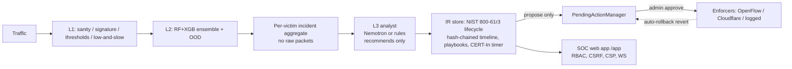

# DDoS Detection & Mitigation Platform: Technical Report (v5.3.0)

Author: Sachit Sharma. Licence: MIT.

## 1. Summary

A layered, defence-in-depth DDoS/DoS detection and **human-approved** response platform for
SDN and cloud-edge networks. It has four layers:
- **L0** approval-gated mitigation;
- **L1** rule detectors;
- **L2** ML ensemble with an OOD signal;
- **L3** LLM/rule analyst that only recommends.

Around them sit an incident-response backend, a SOC web app, and a purple-team lab with
code-enforced containment.

**What the evidence supports**
- **Binary detection on CIC-DDoS2019 is very high, but only same-dataset:** detection rate 100%,
  benign FPR 0.05%, F1 1.000 (99.9% / 0.74% / 0.999 with shortcut features removed). Family
  attribution is weaker: leakage-safe macro-F1 0.52.
- **Outside that dataset, the ML does not hold up.**
  - Cross-dataset CICIoT2023: F1 swings 1.00 → 0.05 depending only on how the 57 unmapped
    features are filled. Inconclusive (§5.2).
  - In the v4.6.1 lab run, the CIC-trained ensemble flagged **0 of 1,452** SYN-flood flows. v5.1.0
    traced this to the training data: lab-shaped flows are 46:1 `Benign` there.
  - **v5.3.0 retrained L2 on CIC + labelled lab traffic (§5.5).**
    - On a **held-out** lab run it detects 99.95% of attack flows (macro-F1 0.80, up from 0.02).
    - CIC leakage-safe macro-F1 rose 0.906 → 0.917.
    - Lab numbers can be inflated by generator bias: train and test come from the same generator.
- **Lab detection, v5.3.0:** rules tuned on DEV runs 2+3 and frozen. On the fresh **held-out** run4:
  - **all 10 attacks detected, and L3 named the expected family for all 10;**
  - **0 false positives** on benign and flash-crowd traffic;
  - flood MTTD 1.2–1.4 s.

  Before v5.3.0, on the same DEV runs, 4 attacks were fully detected, L3 missed SYN, ACK and RST,
  and a flash crowd tripped L1 (§5.3).
- **Live (v5.2.0):** an attack shows on the SOC website 3.8–5.8 s after it starts. Every alert and
  incident now carries a plain-language reason with its numbers (v5.3.0).
- **No model or LLM output can block traffic.** Every mitigation is a PENDING proposal until an
  admin approves it. This is enforced by an AST test. Lab egress containment was measured: 3/3
  probes dropped.

## 2. Architecture

| Layer | Code | Notes |
|---|---|---|
| L0 mitigation gate | `src/mitigation/manager.py` | `propose()` → PENDING; only `approve()` executes; `revert()` only removes |
| L1 detectors | `src/features/` | sanity, signature, threshold, entropy/EWMA, low-and-slow |
| L2 ML | `src/models/` | RF + XGBoost ensemble (77 CICFlowMeter features), isotonic-calibrated OOD (τ at 2% false-OOD) |
| L3 analyst | `src/agent/` | one call per incident, cached, forced tool-call schema, output policy, rule fallback |
| IR backend | `src/ir/`, `src/api/ir_router.py` | SQLite/SQLAlchemy, lifecycle, playbooks, CERT-In, export, rollback, replay |
| SOC app | `dashboard/` | React 19 + Vite + TS; sessions, CSRF, strict CSP, axe-clean |
| Lab | `lab/` | scope/safety, scenarios, gated generator, Mininet orchestrator, nftables containment |

## 3. Key design decisions

1. **The LLM is never in the packet path.** It sees one aggregated, sanitised incident at a
   time. Since v5.1.0 the default model is Nemotron 3.5 Lightning
   (`nvidia/nemotron-3.5-lightning-30b-a3b`, set by `NEMOTRON_MODEL`). In the one live check it
   took 7.9 s per analysis. Ultra took 27–46 s and is now an opt-in escalation for severity-5
   incidents (`DDOS_LLM_ESCALATE_ULTRA`, off by default). Neither could be in the fast path.
   Timeouts fall back to a deterministic rule analyst, which is also used in tests and CI.
2. **Recommend, never execute.** Mitigation needs `PendingActionManager.approve()` with an admin
   credential. `tests/test_mitigation_bypass.py` scans the code for any other path to
   execution, and `tests/test_ir.py::TestNoDirectEnforcement` does the same for the IR code.
3. **Time-boxed blocks.** Incident-linked approved blocks revert after a TTL (default 10 min)
   unless an admin extends them with a reason. This limits the blast radius of a wrong call.
4. **Tamper-evident records.** Every incident event is SHA-256 hash-chained, and exports show the
   verification result.
5. **Honest evaluation over impressive numbers.** Same-dataset results are always labelled as
   such. Cross-dataset and lab results are reported as measured, including misses.

## 4. Safety model

- **LLM:** telemetry is treated as untrusted. It is sanitised and wrapped in `<telemetry>`, and a
  code-enforced output policy pins the incident id, forces `requires_human`, drops actions that
  target IPs outside the incident, and redacts canaries. Injection eval: 34% success without
  defences → **0/31** with prompt defences (95% upper bound ≈ 10%; static payloads only). The
  regex instruction detector does **not** generalise (0/12 held-out), and no safety property
  depends on it.
- **Human in the loop:** RBAC (analyst vs admin, deny by default, endpoint × role matrix test),
  confirmation dialogs, a reason required for reject/extend/permanent, and the approver recorded
  in the hash-chained timeline.
- **Web:** HttpOnly/Secure/SameSite=Strict sessions, synchroniser CSRF, strict CSP (no inline
  script or style), raw-HTML rendering banned by lint, same-origin WebSocket cookie auth, rate
  limits on login, writes and LLM chat.
- **Lab:**
  - code-enforced scope (private allowlisted /24 only; public IPs refused);
  - rate/duration/concurrency caps; kill switch checked every tick;
  - refuses to run outside WSL2 + a Mininet network namespace;
  - per-packet source/destination guard; nftables egress drop.
  Traffic code was added only after explicit owner approval.

## 5. Evaluation

### 5.1 Same-dataset (CIC-DDoS2019)
Train vs a separate extraction with exact duplicates removed. Note: about 13k identical rows are
shared, so this is the same recordings re-split, not an independent capture. Binary:
- detection **100%**, benign FPR **0.05%**, F1 **1.000**;
- with shortcut features removed: 99.9% / 0.74% / 0.999.

Family macro-F1: **0.52** leakage-safe vs 0.85 under a leaky random split. Full tables:
`docs/EVAL_NOTES.md`.

### 5.2 Cross-dataset (CICIoT2023 CSV sample, v4.4.0)
CICIoT2023 publishes packet-window features, not CICFlowMeter flows, so only **20 of 77** features
can be mapped. Results on 6,000 rows (Benign / SYN flood / UDP flood) depend on how the other 57
are filled:

| Fill | Attack F1 | Benign FPR |
|---|---:|---:|
| zero | 1.000 | 0.0% |
| CIC-DDoS2019 benign median | 0.050 | 0.1% |
| production path | 0.966 | 14.2% |

A two-line protocol rule also catches every attack (benign FPR 36.9%). **Inconclusive**: this
measures sensitivity to a feature-schema mismatch, not generalisation. Details:
`docs/eval/cross_dataset.md`.

### 5.3 Purple-team lab (Mininet on WSL2, v4.6.1 + v5.1.0 + v5.3.0)

**v5.3.0, DEV vs HELD-OUT** (`docs/purple_team/dev_vs_heldout.md`):
- Rules tuned on runs 2+3 (DEV), then frozen.
- **run4** (fresh seed, never tuned on) was analysed once, after the freeze.

| | DEV | HELD-OUT run4 |
|---|---|---|
| Attacks detected / L3 expected family | 10/10 / 10/10 | **10/10 / 10/10** |
| False positives (benign, flash crowd) | 0, 0 | **0, 0** |
| Flood MTTD | 0.9–1.5 s | **1.2–1.4 s** |

Held-out found one new L2 false-positive source: 2-packet connection fragments the victim sent just
before two scenarios started (12 flows, §5.5).

**Before v5.3.0** (the numbers below):
12 scenarios in two runs, ~650k packets: `run2` (8 scenarios, v4.6.1) and `run3` (ICMP, ACK, RST and
LAND floods, v5.1.0; 282,032 packets). Captured at the victim and run through the real L1 / L2 /
OOD / rule L3 stack (`docs/purple_team/README.md`):
- **Containment proven in both runs:** with a NAT path deliberately open, 3/3 probes were dropped
  at the lab boundary; 0 appeared on the uplink.
- **Detected:** UDP flood, NTP reflection (simulated reflector), HTTP low-and-slow, ICMP flood.
- **Partial:**
  - SYN flood (L1 + OOD only; L3 and L2 did not detect it);
  - DNS reflection (generic UDP family);
  - novel/OOD mix (OOD flagged 48%);
  - ACK flood (L2 flagged 1,486/1,490 but as UDP reflection; L3 did not detect it);
  - RST flood (L2 13/1,482; L3 did not detect it);
  - LAND (one flow; L3 called it a SYN flood).
- **False positives:** flash crowd (L1 on 41% of flows), benign baseline (3%).
- **L2 flagged 0/1,452 sampled SYN-flood flows** (all `Benign`), 0/20 ICMP flows, and 1–16% on
  the UDP floods.
  - Cause, investigated in v5.1.0: the lab SYN flows are 17 µs answered handshakes (SYN, SYN-ACK,
    RST). CIC-DDoS2019 `Syn` flows are ~40 s and mostly unanswered.
  - In the training set, flows of the lab shape are 212 `Syn` vs 9,762 `Benign`.
  - No feature is missing; the training distribution does not cover this traffic.
  - Not retrained: an honest fix needs labelled lab-shaped traffic independent of the evaluation
    run (§7).
- **L3 SYN-flood result corrected in v5.1.0.** It was "HTTP flood / low-and-slow", because the lab
  aggregate counted zero-payload handshakes to :443 as HTTP requests. After the fix it is **not
  detected**: the SYN-flag ratio of an answered flood is 2/3, under the rule's 0.7. Not retuned on
  this run.
- MTTD ≈ 1–1.5 s for the floods after flow export (≈ 61 s with a 60 s idle-timeout exporter);
  low-and-slow 117 s. ICMP 55.8 s and LAND 60.8 s are bound by their few long flows ending with the
  scenario, not by detector speed.
- The run found a product bug (UDP floods routed to the zero-day playbook), now fixed.

### 5.5 L2 retrained on CIC + lab traffic (v5.3.0)

The recipe was fixed before any held-out number existed: XGBoost, 120 trees, depth 7, and
per-class caps (CIC 12,000, lab 5,000). It is the model `/score/flow` uses.

- **Training data:** CIC-DDoS2019 plus `train1`, 22 labelled lab variants at rates, sources and
  ports that differ from every evaluation scenario, with their own seed.
- **Deploy rule, judged on CIC only:** CIC macro-F1 may drop by ≤ 0.05 and benign FPR rise by
  ≤ 1 point. It passed (+0.011 / +0.07 pt).

Each set is reported separately and never averaged (`docs/eval/l2_retrain/`).

| Set | Macro-F1, before → after | Benign FPR | Attack detection |
|---|---:|---:|---:|
| CIC test_real_v2 (separate extraction) | 0.906 → **0.917** | 0.06% → 0.13% | 99.99% → 99.98% |
| DEV lab (runs 2+3) | 0.021 → **0.872** | 0% → 0% | 15.4% → **99.95%** |
| **HELD-OUT lab (run4)** | 0.018 → **0.800** | 0.14% → 0% | 20.2% → **99.95%** |

Macro-F1 uses one coarse family taxonomy for every model. The deployed model had merged reflection
classes, so its native class names would not compare like with like.

**Per class on held-out (after):**
- **About 1.00 F1:** Syn, ACK, RST, LAND.
- **Weak (recall):** UDP 0.97, Slowloris 0.50, Reflection (NTP+DNS) 0.32, ICMP 0.27. An ICMP flood
  is only a few long flows, so there were just 50 training flows.

**Held-out finding:** L2 labels 2-packet TCP connection fragments as an "ACK" flood: 12 flows that
the victim sent just before two scenarios started. This made those raw MTTDs negative. Counting
only flows after the start, ICMP is 0.15 s and low-and-slow 118.1 s. It was not tuned away on the
held-out run.

**Caveat:** one generator and one network produced train, DEV and held-out, so the lab numbers are
an upper bound for real traffic.

### 5.4 Threat hunts (v4.7.0)
Two hypothesis-driven rules: H1 low-rate distributed reflection, H2 distributed slow-read. Each
has positive and negative tests. Run over the ~221k lab flows they found **nothing**, which is
expected for that data. Their inputs were verified as populated, and neither fires on the flash
crowd. They have not been validated on positive traffic yet.

## 6. Security assessment and GRC
- STRIDE threat model, 18 threats: `docs/security/STRIDE.md`.
- Bug hunt, 12 items (3 fixed in v4.7.0 with regression tests): `docs/security/bug_hunt.md`.
- Control mapping to NIST CSF 2.0, ISO/IEC 27001:2022 Annex A, CIS v8, CERT-In and D3FEND:
  `docs/grc/control_mapping.md`.
- Risk register (12 risks, inherent and residual): `docs/grc/risk_register.md`.
- CI: CodeQL (Python + JS/TS), Bandit, gitleaks, pip-audit, npm audit, CycloneDX SBOM per release,
  Playwright + axe-core, and this report's citation check.

## 7. Limitations
1. ML generalisation outside the lab is unproven.
   - v5.3.0 L2 is good on a held-out lab run (99.95% attack detection) only after training on
     lab traffic from the same generator, which is likely an inflated upper bound.
   - It is weak on ICMP, reflection and Slowloris classes, and false-positives on 2-packet TCP
     fragments.
   - Real-world detection still rests mostly on rules.
   - The text below records the pre-v5.3.0 state.
   The lab SYN miss is a training-distribution gap: answered sub-millisecond handshakes are
   overwhelmingly `Benign` in CIC-DDoS2019, so the ensemble is not expected to flag them.
2. L1 fixed thresholds false-positive on legitimate surges.
3. The production low-and-slow rule still counts zero-byte flows ≥ 10 s as slow, which overlaps
   with SYN floods. The L3 SYN rule (SYN ratio ≥ 0.7) cannot fire on an answered SYN flood (ratio
   2/3). The rule analyst has no ACK, RST or LAND rule. The reflection rule reads
   destination rather than source ports.
4. No same-extractor cross-dataset test (CICIoT2023/CIC-IDS2017 pcaps through our extractor).
5. Shared API keys, no per-user identity or MFA. `/metrics` is unauthenticated. Model artifacts
   are not hash-pinned.
6. Lab rates are modest (≤1,500 pkt/s, Python/scapy) and from a single host; no multi-Gbps floods.
7. The injection evaluation uses static payloads; adaptive attacks are untested.
8. **The LLM can name an attack wrongly** (measured).
   - In live run 2 (v5.2.0), Nemotron 3.5 Lightning called a live **UDP flood "Benign / flash
     crowd"**. It named the SYN and ICMP floods correctly.
   - This is a measured triage error, not fixed by hard-coding.
   - The rule analyst's verdict is shown next to the LLM's on every incident (v5.3.0).
9. The LLM provider is not reliable enough to depend on. At release time the live NVIDIA NIM
   check timed out (60 s) after an earlier HTTP 503. The platform falls back to the deterministic
   rule analyst, which is why no safety property depends on the LLM.
   v5.1.0 live check with Lightning, run once:
   - The first call returned no content: the model spent 911 of 1,024 tokens on reasoning and was
     cut off (`finish_reason=length`).
   - With reasoning disabled (`enable_thinking: false`) the live test passed in 7.9 s.
   - A forced tool call in the probe returned severity 8, outside the 1–5 schema range. Schema
     validation, retry and the rule fallback handle this, but it shows model output cannot be
     trusted as-is.

## 8. Future work
Retrain or adapt the ML on lab and CICIoT2023 pcaps through our own extractor; adaptive
per-destination L1 baselines; handshake-aware low-and-slow and source-port reflection rules;
an answered-SYN-flood rule and ACK/RST/LAND rules for L3, validated on a fresh lab run; labelled
lab-shaped SYN traffic from a run separate from the evaluation, for ML retraining; lab
scenarios for ≥50 reflectors and slow-read; artifact hash pinning; per-user OIDC sign-in; an
externally anchored timeline head hash.

## 9. References
- I. Sharafaldin, A. H. Lashkari, S. Hakak, A. A. Ghorbani, "Developing Realistic Distributed
  Denial of Service (DDoS) Attack Dataset and Taxonomy," ICCST 2019. Dataset:
  <https://www.unb.ca/cic/datasets/ddos-2019.html>
- E. C. P. Neto et al., "CICIoT2023: A Real-Time Dataset and Benchmark for Large-Scale Attacks in
  IoT Environment," *Sensors*, 2023. Dataset: <https://www.unb.ca/cic/datasets/iotdataset-2023.html>
- NIST SP 800-61r3, *Incident Response Recommendations and Considerations for Cybersecurity Risk
  Management* (2025): <https://csrc.nist.gov/pubs/sp/800/61/r3/final>
- NIST Cybersecurity Framework 2.0: <https://www.nist.gov/cyberframework>
- CERT-In Directions u/s 70B(6), No. 20(3)/2022-CERT-In, 28 April 2022:
  <https://www.cert-in.org.in/PDF/CERT-In_Directions_70B_28.04.2022.pdf>
- MITRE ATT&CK T1498 Network Denial of Service: <https://attack.mitre.org/techniques/T1498/>;
  T1499 Endpoint Denial of Service: <https://attack.mitre.org/techniques/T1499/>
- MITRE D3FEND: <https://d3fend.mitre.org/>
- ISO/IEC 27001:2022: <https://www.iso.org/standard/27001>
- CIS Critical Security Controls v8: <https://www.cisecurity.org/controls/v8>
- Mininet: <https://mininet.org/>
